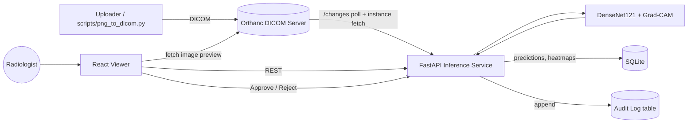

# AI-Assisted Medical Imaging & Diagnosis System

> ⚠️ **FOR EDUCATION ONLY. NOT FOR CLINICAL USE.**
> This project is a learning prototype. It has not been validated on clinical data, is not a medical device, and must never be used to diagnose, treat, or make decisions about real patients.

An end-to-end platform where chest X-rays are uploaded as DICOM, analyzed by a deep learning model, shown with Grad-CAM explanation heatmaps, and reviewed by a radiologist who can Approve or Reject each AI finding. Every decision is written to an audit log.


---

## Table of Contents

1. [Overview](#overview)
2. [Features](#features)
3. [Project Status](#project-status)
4. [Architecture](#architecture)
5. [Tech Stack](#tech-stack)
6. [Repository Structure](#repository-structure)
7. [Dataset](#dataset)
8. [Model](#model)
9. [Explainability (Grad-CAM)](#explainability-grad-cam)
10. [DICOM Integration (Orthanc)](#dicom-integration-orthanc)
11. [API Reference](#api-reference)
12. [Radiologist Viewer](#radiologist-viewer)
13. [Audit Log](#audit-log)
14. [Setup & Installation](#setup--installation)
15. [Training & Evaluation](#training--evaluation)
16. [Testing](#testing)
17. [Results](#results)
18. [Limitations & Bias](#limitations--bias)
19. [Ethics & Safety Notice](#ethics--safety-notice)
20. [Roadmap](#roadmap)
21. [Contributing](#contributing)
22. [References & Acknowledgements](#references--acknowledgements)
23. [License](#license)

---

## Overview

Radiologists read large volumes of scans, and AI can help prioritize and flag findings. But a model that outputs a bare label is hard to trust. This project explores a **human-in-the-loop** design:

1. A scan arrives in a DICOM server (Orthanc).
2. A backend service detects the new study, runs inference, and generates a Grad-CAM heatmap showing which region influenced the prediction.
3. A web viewer shows the scan, the AI overlay, and a confidence score.
4. A radiologist **approves or rejects** the AI output, and the decision is permanently logged.

The goal is to demonstrate a complete, containerized ML system: data versioning, model training, explainability, DICOM interoperability, a review UI, and an audit trail. It is **not** to build a clinically accurate classifier.

## Features

- DICOM ingestion through an Orthanc server
- Multi-label chest X-ray classification with a transfer-learned DenseNet121
- Patient-level train/validation/test split (no patient leakage)
- Grad-CAM heatmap for every prediction
- FastAPI backend that polls Orthanc, runs inference, and stores results
- React viewer with heatmap toggle, opacity control, confidence scores, and Approve/Reject
- Append-only audit log of every reviewer decision (who, what, when, model version)
- Dataset and model versioning with DVC
- One-command deployment with Docker Compose
- Automated tests and a documented model card

## Project Status

Update this table honestly as you go. Only mark an item done when it works.

| Component | Status |
|---|---|
| Repo, folder structure, Docker Compose skeleton | ☐ |
| Data download + DVC tracking | ☐ |
| Preprocessing + patient-level split | ☐ |
| DenseNet121 training + evaluation | ☐ |
| Grad-CAM explanations | ☐ |
| PNG → DICOM conversion + Orthanc | ☐ |
| FastAPI inference service | ☐ |
| React viewer (Approve/Reject) | ☐ |
| Audit log | ☐ |
| Automated tests | ☐ |
| 3D segmentation (MONAI U-Net) | ☐ Stretch goal, not started |
| Demo recording + presentation | ☐ |

## Architecture



**Flow:**
1. A DICOM study is uploaded to Orthanc.
2. The API service polls Orthanc's `/changes` endpoint and downloads new instances.
3. The service preprocesses the image, runs the model, and computes a Grad-CAM heatmap.
4. Predictions, heatmap path, and model version are stored in SQLite.
5. The viewer lists studies, displays the scan with the overlay, and sends the radiologist's decision back to the API.
6. Each decision is appended to the audit log.

More detail is in [`docs/architecture.md`](docs/architecture.md).

## Tech Stack

| Layer | Technology |
|---|---|
| Model | PyTorch, torchvision (DenseNet121) |
| Explainability | pytorch-grad-cam |
| Data versioning | DVC (local remote) |
| DICOM | Orthanc, pydicom |
| Backend | FastAPI, Uvicorn, SQLite |
| Frontend | React (Vite) |
| Packaging | Docker, Docker Compose |
| Testing | pytest |

## Repository Structure

```
medical-imaging-ai/
├── README.md
├── docker-compose.yml
├── requirements.txt
├── .gitignore  .dvcignore
├── data/                       # DVC-tracked (not stored in git)
├── models/                     # trained weights (DVC-tracked)
├── src/medimg/
│   ├── data/                   # split.py, preprocess.py, dataset.py
│   ├── models/                 # classifier.py
│   ├── explain/                # gradcam.py
│   ├── train.py
│   └── evaluate.py
├── services/
│   ├── orthanc/                # orthanc.json
│   ├── api/                    # FastAPI service + Dockerfile
│   └── viewer/                 # React app + Dockerfile
├── scripts/
│   └── png_to_dicom.py         # converts sample images to DICOM
├── tests/
├── docs/                       # architecture.md, model_card.md, api.md
└── reports/                    # metrics.json, figures/
```

## Dataset

- **Source:** [NIH Chest X-rays, Sample subset](https://www.kaggle.com/datasets/nih-chest-xrays/sample) (5,606 images from NIH ChestX-ray14, with `sample_labels.csv`).
- **Labels used:** Atelectasis, Effusion, Infiltration, Mass, Nodule, Pneumothorax (multi-label).
- **Split:** 70% train / 15% validation / 15% test, **grouped by Patient ID** so no patient appears in more than one split.
- **Versioning:** raw data and model weights are tracked with DVC. Git stores only the `.dvc` pointer files.

**Preprocessing:**
- Convert to 3 channels, resize to 224×224, normalize with ImageNet statistics
- Training augmentation: small rotation, small translation/scale, brightness/contrast jitter
- **No horizontal flip**, because anatomical asymmetry (for example heart position) is clinically meaningful

> Labels in this dataset were extracted from radiology reports by NLP, so they contain noise. See [Limitations & Bias](#limitations--bias).

## Model

- **Architecture:** DenseNet121 pretrained on ImageNet, with the final layer replaced by a 6-output linear head
- **Loss:** `BCEWithLogitsLoss` with per-class `pos_weight` to handle class imbalance
- **Optimizer:** AdamW, lr 1e-4, weight decay 1e-4
- **Training:** mixed precision on a GPU, best checkpoint chosen by validation mean AUROC
- **Metric:** per-class and mean AUROC on the held-out test set

Full details are in [`docs/model_card.md`](docs/model_card.md).

## Explainability (Grad-CAM)

For each prediction the service computes a Grad-CAM heatmap from the last convolutional block of DenseNet121 and overlays it on the scan. This shows **where the model looked**.

> Grad-CAM is a visual aid, not proof of causation or correct reasoning. A model can attend to the wrong region (for example a chest tube or text marker) and still predict correctly. Failure cases are discussed in the results section.

## DICOM Integration (Orthanc)

- Orthanc runs in Docker and exposes the web UI on port `8042` and DICOM on port `4242`.
- `scripts/png_to_dicom.py` wraps sample PNGs as DICOM files with `pydicom` and uploads them to Orthanc.
- The API polls `GET /changes` for new instances, downloads each one, and runs inference.

> Orthanc authentication is disabled in this demo for simplicity. A real deployment would require authentication, TLS, and access control.

## API Reference

Base URL: `http://localhost:8000`

| Method | Endpoint | Description |
|---|---|---|
| `GET` | `/health` | Service health check |
| `GET` | `/studies` | List studies with status (pending / approved / rejected) |
| `GET` | `/studies/{id}` | Predictions, confidence scores, heatmap URL, model version |
| `POST` | `/studies/{id}/decision` | Submit `{"reviewer": "...", "decision": "approve" or "reject", "comment": "..."}` |
| `GET` | `/audit` | Read the audit log |

Interactive docs are available at `http://localhost:8000/docs` (Swagger UI). More details are in [`docs/api.md`](docs/api.md).

## Radiologist Viewer

The React viewer (`http://localhost:5173`) provides:
- A study list with review status
- The scan with a toggleable Grad-CAM overlay and opacity slider
- Per-finding confidence scores
- **Approve / Reject** buttons with an optional comment
- A permanent "For education only, not clinical use" banner

## Audit Log

Every decision is stored as an append-only record:

| Field | Description |
|---|---|
| `id` | Unique record ID |
| `study_id` | The reviewed study |
| `reviewer` | Reviewer name or ID |
| `decision` | `approve` or `reject` |
| `comment` | Optional free text |
| `model_version` | Model that produced the prediction |
| `timestamp` | UTC time of the decision |

Records are never updated or deleted through the API.

## Setup & Installation

**Prerequisites:** Docker and Docker Compose, Git. For local training and development also Python 3.10+ and Node 18+.

### Run with Docker (recommended)

```bash
git clone https://github.com/<your-username>/medical-imaging-ai.git
cd medical-imaging-ai

# Pull data and model weights (requires the DVC remote)
pip install dvc
dvc pull

docker compose up --build
```

| Service | URL |
|---|---|
| Viewer | http://localhost:5173 |
| API docs | http://localhost:8000/docs |
| Orthanc | http://localhost:8042 |

### Load sample studies

```bash
python scripts/png_to_dicom.py --src data/raw/images --n 20 --orthanc http://localhost:8042
```

### Local development (without Docker)

```bash
python -m venv .venv
source .venv/bin/activate        # Windows: .venv\Scripts\activate
pip install -r requirements.txt

uvicorn services.api.main:app --reload     # backend
cd services/viewer && npm install && npm run dev   # frontend
```

## Training & Evaluation

```bash
# 1. Create patient-level splits
python -c "from medimg.data.split import make_splits; make_splits('data/raw/sample_labels.csv', 'data')"

# 2. Train
python -c "from medimg.train import run; run('data', 'data/raw/images', out='models/best.pt')"

# 3. Evaluate on the held-out test set (run once, after training is finished)
python -m medimg.evaluate --weights models/best.pt --split data/test.csv
```

Training was run on a free Kaggle GPU. See `notebooks/` for the notebook used.

## Testing

```bash
pytest -v
```

Tests cover preprocessing output shape and range, model output shape, the decision endpoint, and audit log writes.

## Results

> Fill this section with your real numbers after evaluation. Do not edit numbers to look better.

**Test-set AUROC (held-out, patient-level split):**

| Finding | AUROC |
|---|---|
| Atelectasis | TBD |
| Effusion | TBD |
| Infiltration | TBD |
| Mass | TBD |
| Nodule | TBD |
| Pneumothorax | TBD |
| **Mean** | **TBD** |

**Training details:** epochs = TBD, best epoch = TBD, GPU = TBD, training time = TBD.

**Grad-CAM examples:** add 2 correct and 2-3 incorrect predictions in `reports/figures/` and link them here, with a short note on what the heatmap shows in each case.

**Demo:** link to the screen recording here.

## Limitations & Bias

- **Noisy labels:** NIH labels were mined from reports using NLP, not confirmed by experts on the images. Some labels are wrong.
- **Single source:** all images come from one institution. The model has not been tested on other hospitals, scanners, or protocols, so generalization is unknown.
- **Small subset:** training uses a ~5.6k-image sample, so performance is well below published full-dataset models.
- **Demographic bias:** the dataset has limited demographic information and was not audited for performance across age, sex, or ethnicity. Subgroup performance is unknown.
- **Class imbalance:** rare findings have few positive examples, so their metrics are less reliable.
- **Shortcut learning:** models can learn spurious cues (devices, markers, image artifacts) instead of pathology.
- **Grad-CAM limits:** heatmaps are coarse and do not prove the model's reasoning is clinically valid.
- **Calibration:** confidence scores are not calibrated probabilities and should not be read as the chance of disease.
- **Scope:** the system covers 6 findings only. It cannot detect anything else, and a "negative" output does not mean a scan is normal.
- **Security:** the demo has no authentication or encryption and is not suitable for real patient data.

## Ethics & Safety Notice

This software is for **education and research demonstration only**. It is not approved by any regulatory body, must not be used for clinical decision-making, and must not be used with real patient data. All outputs require review by a qualified clinician, and the human review step in this system exists to illustrate that principle, not to make the system safe for clinical use.

## Roadmap

- [ ] 3D segmentation with a MONAI U-Net on a Medical Segmentation Decathlon task
- [ ] External validation on a second dataset (for example CheXpert)
- [ ] Probability calibration (temperature scaling)
- [ ] Subgroup performance analysis
- [ ] Authentication, TLS, and role-based access
- [ ] Support for CT/MRI series viewing

## Contributing

This is a learning project. Issues and suggestions are welcome. Please open an issue before submitting a large pull request.

## References & Acknowledgements

- Wang et al., *ChestX-ray8: Hospital-scale Chest X-ray Database and Benchmarks*, CVPR 2017.
- Huang et al., *Densely Connected Convolutional Networks*, CVPR 2017.
- Selvaraju et al., *Grad-CAM: Visual Explanations from Deep Networks*, ICCV 2017.
- [Orthanc](https://www.orthanc-server.com/), [pydicom](https://pydicom.github.io/), [DVC](https://dvc.org/), [MONAI](https://monai.io/), [pytorch-grad-cam](https://github.com/jacobgil/pytorch-grad-cam).
- NIH Clinical Center for releasing the ChestX-ray14 dataset.

